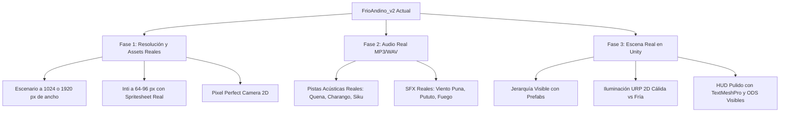

# DIAGNÓSTICO TÉCNICO Y PLAN DE MEJORA: FRÍO ANDINO V2
**Proyecto:** *Frío Andino: Sobrevivir a la Helada*  
**Ubicación analizada:** `/home/gilmer/Escritorio/FrioAndino_v2/`

---

## 1. RESUMEN EJECUTIVO DEL ESTADO ACTUAL

Tras auditar exhaustivamente todo el código (`Assets/Scripts/`), los recursos (`Assets/Resources/FrioAndino/`) y la escena de **FrioAndino_v2**, se identifican dos caras del proyecto:

* **Lo positivo:** La arquitectura lógica de fondo es muy sólida. Las fórmulas térmicas ($T_{interior} = T_{ext} + R_t \times 26 + \text{fogón}$), el ciclo de 5 días con caída a -20°C, el impacto en la salud comunitaria (**ODS 3**) y la protección del rebaño de alpacas (**ODS 13**) están programadas con fidelidad a la realidad andina.
* **El problema crítico:** Para evitar configurar Unity, se forzó una arquitectura "100% por código" que genera arte microscópico, sintetiza sonidos con pitidos matemáticos de CPU y monta una escena invisible al presionar Play, provocando una **calidad visual y sonora muy baja**.

---

## 2. ¿A QUÉ SE DEBE LA "CALIDAD HORRIBLE"? (LOS 4 CULPABLES TÉCNICOS)

### 🔍 Causa 1: Resolución microscópica estirada 7 veces (Pixel Mush)
* En `StageBuilder.cs` y `GameArt.cs`, el escenario panorámico fue recortado y forzado a:
  * `fondo_villa.bytes`: **579 × 100 píxeles**.
  * `suelo.bytes`: **579 × 67 píxeles**.
  * **Alto total del mundo jugable: ¡solo 161 píxeles!**
* **El efecto en pantalla:** Al ejecutar el juego en un monitor Full HD (1920 × 1080), Unity se ve obligado a ampliar esos 161 píxeles casi **7 veces (700% de aumento)**. Al tener activado `FilterMode.Point`, cada píxel se convierte en un ladrillo tosco y gigante de 7x7 píxeles de pantalla. El pueblo se ve borroso y deformado.

### 🔍 Causa 2: Inti mide apenas 22 píxeles de altura
* En `StageBuilder.cs`:
  ```csharp
  public const float PlayerPixelHeight = 22f; // ¡Inti mide solo 22 píxeles!
  public const float VillagerPixelHeight = 20f;
  ```
* El sprite original de Inti (que mide 138 × 253 px o 1024 en el spritesheet) es aplastado por código a un muñequito de 22 píxeles. En la pantalla no se le ve el rostro, ni los detalles del chullo, ni el tejido del poncho. Parece un punto diminuto sin definición.

### 🔍 Causa 3: Bypassear el motor de Sprites nativo de Unity (`.bytes`)
* Las imágenes se renombraron a `.bytes` para cargarse en runtime con `Texture2D.LoadImage()`.
* Esto **anula todas las ventajas de Unity**:
  * No utiliza el importador de Sprites nativo.
  * No utiliza compresión de textura GPU adecuada.
  * No permite usar el Sprite Editor de Unity para cortar frames con precisión.
  * No permite configurar un `Pixel Perfect Camera` nativo que evite el temblor (jitter) al caminar.

### 🔍 Causa 4: Iluminación 2D simulada con un cuadrado de 8×8
* En `WeatherFX.cs`, para no usar URP 2D, se toma un sprite de **8 × 8 píxeles blancos** y se estira sobre toda la pantalla como un velo semitransparente teñido de azul.
* Esto no ilumina ni da atmósfera: simplemente "apaga" y "ensucia" los colores del arte, en vez de tener luces 2D cálidas sobre la fogata y sombras frías de noche.

---

## 3. EL PROBLEMA DE LOS SONIDOS (¿POR QUÉ SUENA EXTRAÑO?)

* **No hay archivos de audio reales:** En `Assets/Scripts/Audio/AudioSynth.cs` hay 509 líneas de código que generan el sonido **con ondas senoidales y matemáticas en la CPU** (`Mathf.Sin`).
* **El resultado acústico:**
  * La quena y zampoña suenan como un teclado electrónico monofónico o un zumbido digital retro de los años 80, no como caña andina.
  * El charango suena metálico y artificial.
  * El viento andino es un acorde de senos a 55 Hz y 110 Hz (parece el zumbido de un motor o un transformador eléctrico, no viento de puna).
  * El fogón es una onda de 68 Hz modulada.
* **La paradoja:** En la carpeta `FrioAndino_v2_CON_TU_ARTE/Claude outputs/` existe un archivo real `tema_dia_nuevo.mp3` de alta fidelidad con quenas e instrumentos acústicos que nunca fue cargado en el juego.

---

## 4. ANÁLISIS DE LA JUGABILIDAD Y LAS ESCENAS

### ¿El juego resuelve la problemática?
**Conceptualmente SÍ, pero experiencialmente está desconectado:**

1. **La fórmula ODS funciona en números:**
   * $T_{interior} = T_{exterior} + (R_t \times 26) + \text{fogón}$.
   * Si no aíslas la casa con ichu o Muro Trombe, los comuneros enferman y pueden morir (ODS 3).
   * Si no metes las alpacas al cobertizo, mueren congeladas (ODS 13).
2. **Pero el jugador no "siente" la comunidad:**
   * **Todo nace de la nada en código (`GameBootstrap.cs`):** La escena `FrioAndino.unity` en Unity está totalmente vacía. No hay GameObjects en la jerarquía, no puedes ver las casas en el Editor, no puedes ajustar colliders visualmente ni acomodar la cámara.
   * **Coordenadas rígidas en píxeles:** `GameBootstrap` tiene valores fijos (`PxCasaWari = 50f; PxCasaInti = 305f;`). Si cambias la imagen de fondo por una en alta resolución, las casas interactivas quedan flotando en lugares donde no hay casas.
   * **El arreo de alpacas es tosco:** Las alpacas son sprites de 17x21 píxeles que rebotan sin animación fluida.

---

## 5. PLAN MAESTRO DE TRANSFORMACIÓN: CÓMO LLEVARLO A NIVEL PROFESIONAL



---

### PASO 1: Restaurar la Resolución Real del Arte (Pixel Art Nítido)
1. **Reemplazar el fondo de 579 px por el arte en resolución nativa (mínimo 1024 px o 1920 px).**
2. **Escalar a Inti a su altura correcta (64 a 96 píxeles / 2 a 3 unidades de Unity):** Así se aprecia su poncho bordado, su chullo y su expresión facial decidida.
3. Importar las imágenes como **Sprites nativos de Unity** (`Sprite Mode: Multiple`, `Filter Mode: Point`, `Compression: None`) en vez de `.bytes`.
4. Añadir **Pixel Perfect Camera** para que la cámara acompañe a Inti con nitidez absoluta y sin saltos de píxel.

### PASO 2: Conectar Audio Real Acústico (Adiós a los Pitidos de Sintetizador)
1. Reemplazar `AudioSynth.cs` por un sistema que reproduzca clips reales:
   * **Día:** La pista acústica `tema_dia_nuevo.mp3` con quena y charango.
   * **Noche:** Audio real de viento andino aullando y notas graves sostenidas.
   * **Pututo:** Grabación real de caracola marina andina con eco de montaña.
   * **Fogón:** Grabación real de leña crepitando con volumen que aumenta al acercarse.

### PASO 3: Construir una Escena Real en Unity (No todo por código en Awake)
1. Abrir la escena `FrioAndino.unity` y montar los objetos en la jerarquía:
   * `Fondo_Escenario` (con las montañas y casas).
   * `Suelo_Pirca` (con `EdgeCollider2D` sobre la nieve y el puente).
   * `Triggers_Casas` (donde Inti se para y presiona `E` para construir el Muro Trombe).
   * `Inti` con su `Rigidbody2D`, `Collider2D` y su Animator con el spritesheet de 3 filas.
2. Esto permite que tú y tu profesor puedan inspeccionar, mover y probar cada elemento en Unity en tiempo real.

### PASO 4: Iluminación 2D que Venda la Helada (URP 2D)
1. Activar el pipeline 2D de URP:
   * **Día:** Luz global cálida dorada (simula el sol de puna a 4,000 m).
   * **Atardecer:** Luz anaranjada que proyecta sombras largas sobre los nevados.
   * **Noche:** Luz global azul marino oscuro (0.15 de intensidad) + **Luz Point 2D brillante** saliendo del fogón comunal y de las ventanas con Muro Trombe.
   * *Impacto visual inmediato:* Verás cómo el caserío se sumerge en una noche helada mientras las casas con Muro Trombe y el fogón brillan como refugios de vida.

### PASO 5: HUD y Feedback de las ODS
1. Reemplazar el HUD de texto simple por una interfaz andina limpia:
   * Termómetro grande que cambia de color: **Verde (+8°C)** $\rightarrow$ **Amarillo (-3°C)** $\rightarrow$ **Rojo/Azul Escarcha (-20°C)**.
   * Barra de salud comunitaria (**ODS 3**) con iconos de comuneros sanos y enfermos.
   * Contador del rebaño de alpacas (**ODS 13**) con Sami en primer plano.
